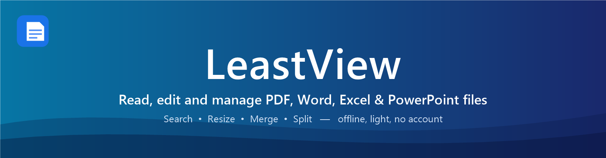
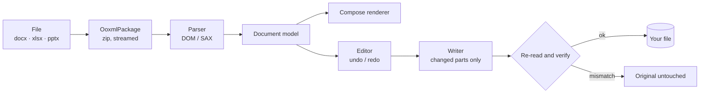

<h1 align="center">LeastView</h1>

<p align="center">
  
</p>

<p align="center"><b><code>One light Android app for every document: view, edit, search, merge, split and resize.</code></b></p>

<p align="center">
  
  
  
  
  
  <a href="https://github.com/aryanvr961/LeastView/actions/workflows/build.yml"></a>
</p>

<p align="center">
  <a href="https://github.com/aryanvr961/LeastView/releases/latest"><b>⬇ Download the APK</b></a>
  &nbsp;·&nbsp; <a href="#-features">Features</a>
  &nbsp;·&nbsp; <a href="#-how-it-works">How it works</a>
  &nbsp;·&nbsp; <a href="#-build-from-source">Build</a>
  &nbsp;·&nbsp; <a href="#-known-limitations">Limitations</a>
</p>

---

**LeastView opens PDF, Word, Excel and PowerPoint files in one small app**, with the dark, clean look of Google Drive's viewer. It also edits them, searches inside them, and ships a toolbox for the jobs people usually open three other apps for: **merge, split and shrink**.

Everything runs on the phone. The app declares **no internet permission**, so a document never leaves the device.

## ✨ Features

### 📖 View anything

| Format | What you get |
|---|---|
| **PDF** | Stacked pages, pinch / double-tap zoom around your fingers, page-by-page fast scroller |
| **DOCX** | Page-fit layout with styles, numbered and bulleted lists, tables, images and links |
| **XLSX** | Grid with column and row headers, number / date formats, colours, merged cells, sheet tabs, pinch zoom |
| **PPTX** | Slides rendered from their layouts and masters: placeholders, fonts, bullets, pictures, tables |
| **TXT, JPG, PNG, WebP** | Text and zoomable image viewers |

Open files from anywhere: LeastView registers as a handler, so WhatsApp, Files, Gmail and browsers show **Open with LeastView**.

### ✏️ Edit

| Format | Editing |
|---|---|
| **DOCX** | Type in place. Bold, italic, underline, strike-through, size, text colour, highlight, alignment, Enter / Backspace, undo / redo |
| **XLSX** | Edit cell values from the formula bar (formula cells are protected) |
| **PPTX** | Tap a text box and rewrite it; the first run's formatting is kept |
| **PDF** | Text-only edit: tap a line, retype it where it stands, and format it with the same toolbar as Word |

**Saving is safe.** Only the parts you changed are rewritten, and the new file is re-opened and checked *before* it replaces the original. If anything looks wrong, the original is left untouched. Read-only sources (a file shared from another app) offer **Save a copy**.

### 🔎 Search

- **Home:** type to filter every document on the device by name, combined with the PDF / DOC / XLS / PPT / TXT / IMG chips.
- **Inside a document:** search the real text of PDF, Word, Excel and PowerPoint files with highlights, **"2 of 12"**, and previous / next. Scanned PDFs say plainly that they have no searchable text.

### 🧰 Tools (drawer menu)

| Tool | What it does |
|---|---|
| **Resizer** | Resize JPG / PNG by percentage or exact size with quality control; shrink PDF, DOCX, PPTX and XLSX by recompressing the pictures inside them (text and layout untouched); before / after previews |
| **Mergers** | Join PDF, TXT, images, Word, Excel and PowerPoint files in the order you choose. Anything that is not a PDF is converted first, and the app asks before doing so |
| **Splitter** | Split a PDF by ranges, extract pages, one file per page, or every N pages, with live range validation |

Choose files from a **Recent files** sheet (newest first, with previews and search), or browse with the system picker. Results are saved straight to your **Documents** folder, or shared. Originals are never modified.

### 🎨 Feels right

Dark Drive-style theme · hamburger drawer · Drive-style **page scroller** with a "4–5/14" pill · pinch zoom that follows your fingers · Android 15-ready edge-to-edge UI.

## 🧠 How it works

LeastView does **not** convert documents to PDF or HTML to show them. Word, Excel and PowerPoint files are zip + XML packages, so each format has its own small parser, model, renderer and writer:



- **Parsers** are plain Kotlin on `org.w3c.dom` / SAX with no Android classes, so they run in fast JVM unit tests that build real `.docx`, `.xlsx` and `.pptx` files, edit them and read them back.
- **PDF** pages are drawn by Android's `PdfRenderer`; text, positions, merge, split and in-place edits come from [PdfBox-Android](https://github.com/TomRoush/PdfBox-Android).
- **Large files** are streamed: the package reader copies untouched zip entries straight through on save, and big sheets are parsed with SAX.

## 📲 Install

1. Download `LeastView-0.1.0.apk` from the [**latest release**](https://github.com/aryanvr961/LeastView/releases/latest).
2. Open it on your phone and allow *Install unknown apps* for your browser or file manager when asked.
3. On first launch, tap **Allow access** to list your documents (or just use **Browse for a file**).

> Requires Android 8.0 (API 26) or newer. Release builds are signed with a debug key for now, so Play Protect may ask for confirmation.

## 🛠 Build from source

```bash
git clone https://github.com/aryanvr961/LeastView.git
cd LeastView
./gradlew testDebugUnitTest      # 30 unit tests
./gradlew assembleRelease        # app/build/outputs/apk/release/
```

You need **JDK 17** and the **Android SDK** (platform 35, build-tools 35.0.0). Android Studio sets all of this up for you; otherwise point `ANDROID_HOME` at your SDK.

## 🗂 Project layout

```
app/src/main/java/com/leastview/app/
├── data/            file kinds, device file listing (MediaStore)
├── office/          OOXML package reader/writer + the three format engines
│   ├── docx/        parser · model · writer      (styles, numbering, tables, images)
│   ├── xlsx/        parser · model · writer      (SAX cells, number formats, themes)
│   └── pptx/        parser · model · writer      (layout / master inheritance)
├── pdf/             viewer, search, line extraction, in-place text editing
├── tools/           PdfBox operations, image resizing, Office→PDF converters, saving
└── ui/              Compose screens: home, drawer, viewers, editors, tools, shared widgets
```

## 🧩 Built with

| | |
|---|---|
| Language / UI | Kotlin 2.0 · Jetpack Compose · Material 3 |
| PDF | Android `PdfRenderer` · [PdfBox-Android](https://github.com/TomRoush/PdfBox-Android) 2.0.27 |
| Office files | Own parsers on DOM / SAX, no Apache POI |
| Images | `BitmapFactory` · AndroidX ExifInterface |
| Tests | JUnit 4 (30 tests, real generated documents) |

## ⚠️ Known limitations

LeastView is **0.1.0**, an early release. Honest edges:

- **PDF text edit** hides the original line with the page colour and draws the new text on top; the old text is still inside the file (this is editing, not redaction). Formatting applies to a whole line, and built-in fonts may look slightly different from the original.
- **DOCX:** no real pagination (the document is one scaled page), no headers / footers / fields; paragraphs that contain fields, drawings or content controls are read-only.
- **XLSX:** formula cells are read-only and other cells' cached results refresh only when opened in Excel.
- **PPTX:** edits are plain text per text box; charts and SmartArt show a placeholder.
- **Mergers:** Office files can only be merged as a PDF, not into one editable document.
- Legacy `.doc`, `.xls` and `.ppt` files are not supported, and password-protected PDFs are not opened.

## 🗺 Roadmap

- [ ] Native DOCX → DOCX and XLSX → XLSX merge
- [ ] Per-word formatting in PDF text edit, and removal of the original text
- [ ] Real pagination for Word files, headers and footers
- [ ] Password-protected PDFs
- [ ] Signing with a release key and a Play Store listing

## 🤝 Contributing

Bug reports and ideas are welcome: open an [issue](https://github.com/aryanvr961/LeastView/issues) and attach the file type (and, if you can share it, a sample) that misbehaved. Pull requests should keep `./gradlew testDebugUnitTest` green.

## 💙 Support

If LeastView saves you time, you can support development over UPI: **`aryanvr961@ybl`** (the QR is in the app under *About*).

## 👤 Credits

Developed by **Aryan Verma**. Thanks to the authors of PdfBox-Android and the AndroidX / Compose teams, and to the open-source document apps whose architecture (format → model → layout → render) inspired the design.
